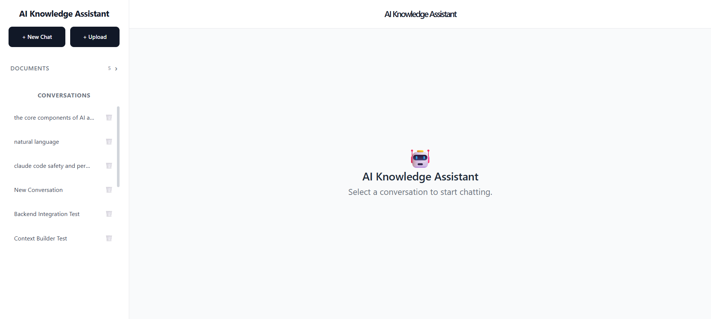
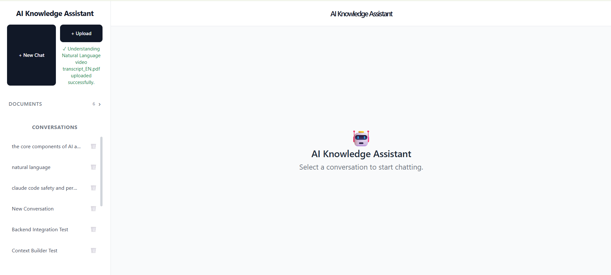
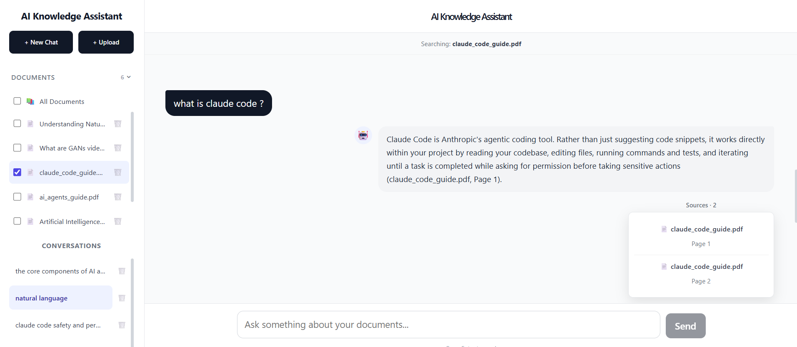
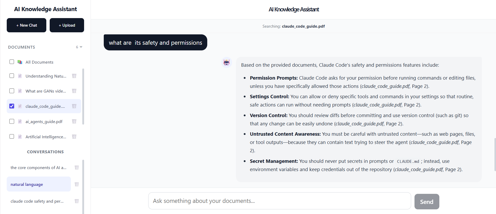
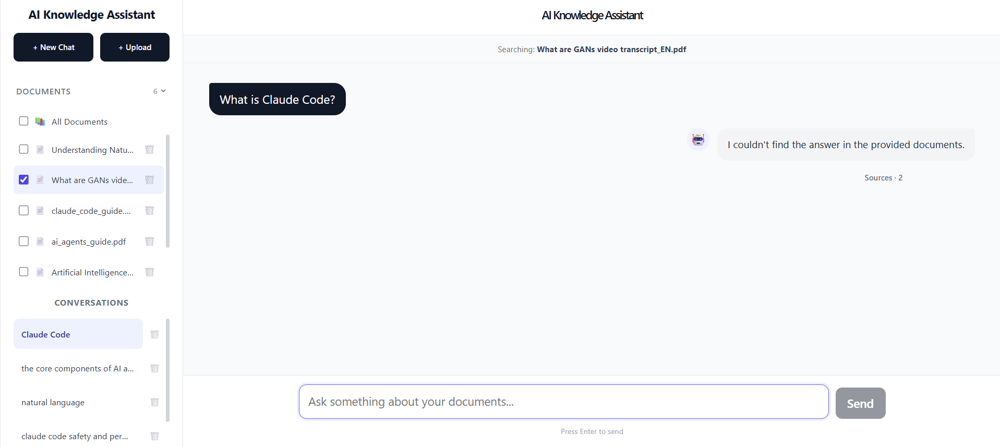

# AI Knowledge Assistant

A full-stack Retrieval-Augmented Generation (RAG) document chatbot that allows users to upload documents, ask questions about them, and receive grounded answers with source citations.

Built with **FastAPI, ChromaDB, Gemini, and React**.

## Overview

The AI Knowledge Assistant is designed for users who need to search and interact with information contained in their own documents.

Instead of sending an entire document collection to an LLM, the system retrieves the most relevant document chunks for each question and provides them as context to the model before generating an answer.

### Who is it useful for?

- Students working with lecture notes, textbooks, and study material
- Developers querying technical documentation
- Researchers exploring collections of documents
- Teams building internal knowledge assistants
- Anyone who needs question-answering over their own documents

## Application Screenshots

### App Overview



### Document Upload



### RAG Answer with Source Citations



### Conversation Follow-up



### Unsupported Question Handling



## Key Features

- PDF and TXT document upload
- Page-aware PDF text extraction
- Structure-aware document chunking
- Gemini embeddings
- Semantic vector search with ChromaDB
- Retrieval-Augmented Generation with Gemini
- Source citations with document and page information
- Conversation history and follow-up questions
- Document-specific retrieval filtering
- Grounded responses for supported questions
- Refusal of unsupported questions
- FastAPI REST API with interactive Swagger documentation
- React frontend
- SQLite-based conversation persistence
- Retrieval evaluation
- Generation and grounding evaluation
- Production-oriented error handling

## How It Works

```text
User uploads documents
        |
        v
Document ingestion
        |
        v
PDF / TXT text extraction
        |
        v
Structure-aware chunking
        |
        v
Gemini embeddings
        |
        v
ChromaDB vector store
        |
        |
        |       User question
        |             |
        |             v
        +----> Semantic retrieval
                      |
                      v
              Relevant chunks
                      |
                      v
                Context builder
                      |
                      v
                  Gemini LLM
                      |
                      v
             Answer + citations
```

In simple terms:

**Upload → Extract → Chunk → Embed → Retrieve → Generate → Cite**

The LLM is given relevant retrieved context rather than the entire document collection for every question.

## Architecture

```text
React Frontend
       |
       | HTTP / REST
       v
FastAPI Backend
       |
       +-----------------------+
       |                       |
       v                       v
Document Ingestion       Conversation Layer
       |                       |
       v                       v
PDF/TXT Loader             SQLite
       |
       v
Structure-aware
Chunking
       |
       v
Gemini Embeddings
       |
       v
ChromaDB
       |
       v
Retrieval
       |
       +----> Contextualized Query
       |
       v
Context Builder
       |
       v
Gemini Generation
       |
       v
Answer + Sources
```

## Engineering Decisions

### FastAPI for the backend

FastAPI was chosen to provide a clean REST API layer with request validation, automatic OpenAPI documentation, and support for asynchronous file handling.

### ChromaDB for vector storage

ChromaDB provides local persistent vector storage suitable for the current single-user application without introducing unnecessary infrastructure.

### Gemini for embeddings and generation

Gemini is used for both document embeddings and answer generation, keeping the AI layer consistent while allowing the retrieval and generation stages to remain separate.

### Page-aware document processing

PDF text is extracted page-by-page so page information can be preserved as metadata and returned with retrieved sources.

### Structure-aware chunking

The project uses structure-aware chunking rather than relying only on fixed-size splitting. Logical sections are preserved when possible, large sections are split at paragraph boundaries, and recursive character splitting is used as a fallback.

### Conversation context is conditional

The application does not blindly send the entire conversation history to the model for every question.

Recent messages are considered when determining whether a follow-up question depends on previous context. Document retrieval remains the primary source of knowledge.

### Evaluation before advanced RAG

Advanced techniques such as hybrid search and reranking were not added simply because they are common RAG features.

The project follows:

```text
Evaluate
   |
   v
Identify the actual problem
   |
   v
Determine whether a technique solves it
   |
   v
Implement
   |
   v
Evaluate again
```

This keeps the architecture focused and avoids adding unnecessary complexity.

## Core RAG Components

### 1. Document Ingestion

Users can upload PDF and TXT documents through the application.

PDF files are processed page-by-page so that page information can be preserved and returned with retrieved sources.

### 2. Structure-Aware Chunking

The system does not rely only on fixed-size character splitting.

It first detects logical structures such as:

- Numbered sections
- Subsections
- Chapters
- Section headings
- Markdown headings

Large sections are then split at paragraph boundaries before falling back to recursive character splitting when necessary.

This helps preserve related information within the same retrieval unit.

### 3. Embeddings and Vector Search

Document chunks are converted into vector embeddings using Gemini and stored in ChromaDB.

When a user asks a question:

```text
Question
   |
   v
Query embedding
   |
   v
Vector similarity search
   |
   v
Top relevant document chunks
```

### 4. Contextualized Retrieval

For follow-up questions, the system can use recent conversation context to determine whether the question depends on the previous exchange.

The resulting contextualized query is then used for document retrieval.

This avoids blindly sending the entire conversation history to the LLM for every request.

### 5. Grounded Generation

Retrieved document chunks are passed to Gemini as evidence for the answer.

The generation layer is instructed to use the retrieved context and avoid treating document content as instructions.

This creates a boundary between retrieved knowledge and model instructions and helps reduce unsupported answers.

### 6. Source Citations

Retrieved chunks retain metadata including:

- Document ID
- Source filename
- Page number
- Chunk index

This metadata is returned with generated answers so users can identify where the information came from.

Example:

```text
transformers_guide.pdf — Page 2
```

### 7. Conversation Context

The application supports follow-up questions within conversations.

For example:

```text
User: What are Transformers?

Assistant: ...

User: Why did they replace RNNs?
```

The second question can use relevant recent conversation context while still retrieving supporting information from the document collection.

### 8. Document Filtering

Users can select a specific document when asking questions.

The retrieval layer can then restrict the search to that document rather than searching the entire collection.

### 9. Unsupported Questions

The system was tested with questions that were outside the available document knowledge.

For unsupported questions, the assistant is designed to avoid presenting unrelated retrieved information as a confident answer.

This behavior was specifically included in the generation evaluation.

## Evaluation

Evaluation was treated as an important part of the RAG system rather than an optional final step.

The project evaluates both:

1. **Retrieval quality**
2. **Generated answer quality and grounding**

### Retrieval Evaluation

A test dataset was created containing answerable and unanswerable queries.

Retrieval was evaluated using:

- Precision@3
- Recall@3
- Mean Reciprocal Rank (MRR)

Current evaluation results:

| Metric | Result |
|---|---:|
| Average Precision@3 | 0.5833 |
| Average Recall@3 | 1.0000 |
| Average MRR | 1.0000 |


The tested answerable queries consistently retrieved relevant information.

For unsupported queries, the vector search still returns the nearest available chunks because semantic search always produces candidates. The generation layer is responsible for determining whether the retrieved context actually supports an answer and refusing unsupported questions when appropriate.

### Generation and Grounding Evaluation

Generation was tested using both supported and unsupported questions.

The evaluation checked whether:

- Answers were supported by retrieved document context
- Relevant source citations were returned
- Follow-up questions used appropriate context
- The system refused unsupported questions
- The model avoided confidently answering questions outside the available documents

Tested scenarios included:

- RAG-related questions
- Transformer-related questions
- Transformer vs RNN questions
- Questions about hallucination reduction
- Unsupported quantum computing questions
- Unsupported combinations of unrelated concepts

The generation tests passed for the tested scenarios, including correct refusal behavior for unsupported questions.


### Evaluation-Driven Development

Advanced RAG techniques were not added simply because they are common features.

The project follows:

```text
Evaluate
   |
   v
Identify the actual problem
   |
   v
Determine whether a technique solves it
   |
   v
Implement
   |
   v
Evaluate again
```

For the current evaluation dataset, the existing retrieval pipeline was sufficient. Therefore, techniques such as hybrid search and reranking were not added unnecessarily.

## Tech Stack

### Backend

- Python
- FastAPI
- Uvicorn
- Gemini API
- ChromaDB
- PyMuPDF
- LangChain Text Splitters
- SQLite

### Frontend

- React
- Vite
- React Markdown
- JavaScript
- CSS

### AI / RAG

- Gemini LLM
- Gemini Embeddings
- Vector similarity search
- Retrieval-Augmented Generation
- Structure-aware chunking

## Project Structure

```text
ai-knowledge-assistant/
|
+-- app/
|   |
|   +-- ingestion/
|   |   +-- loader.py
|   |   +-- chunker.py
|   |   +-- indexer.py
|   |
|   +-- embeddings/
|   |   +-- embedder.py
|   |
|   +-- vectorstore/
|   |   +-- chroma.py
|   |
|   +-- retrieval/
|   |   +-- retriever.py
|   |   +-- contextualizer.py
|   |   +-- context_builder.py
|   |
|   +-- generation/
|   |   +-- generator.py
|   |
|   +-- evaluation/
|   |   +-- retrieval.py
|   |   +-- generation.py
|   |   +-- runner.py
|   |   +-- dataset.py
|   |
|   +-- database.py
|   +-- gemini_service.py
|   +-- config.py
|   +-- main.py
|
+-- frontend/
|   +-- src/
|       +-- components/
|       +-- App.jsx
|       +-- App.css
├── screenshots/
│   ├── app-overview.png
│   ├── document-upload.png
│   ├── rag-answer-sources.png
│   ├── conversation-follow-up.png
│   ├── unsupported-question.png
│   ├── Retrieval evaluation runner1.png
│   ├── Retrieval evaluation runner2.png
│   ├── Generation evaluation runner1.png
│   ├── Generation evaluation runner2.png
│   ├── Generation evaluation runner3.png
│   └── Generation evaluation runner4.png
|
+-- requirements.txt
+-- README.md
+-- .gitignore
```

## API

The backend exposes REST endpoints for:

- Health checks
- Document upload
- Document listing and details
- Document deletion
- Conversation creation
- Conversation listing
- Message retrieval
- RAG chat
- Retrieval evaluation

FastAPI automatically provides interactive API documentation through Swagger UI.

When running locally, the Swagger UI is available at:

```text
http://127.0.0.1:8000/docs
```

## Running Locally

### Backend

Clone the repository:

```bash
git clone https://github.com/Suprajaa2505/ai-knowledge-assistant.git
cd ai-knowledge-assistant
```

Create and activate a Python environment:

```bash
python -m venv venv
```

Activate it on Windows:

```powershell
venv\Scripts\Activate.ps1
```

Install dependencies:

```bash
pip install -r requirements.txt
```

Create a `.env` file:

```env
GEMINI_API_KEY=your_api_key_here
```

Start the backend:

```bash
uvicorn app.main:app --reload
```

The API will be available at:

```text
http://127.0.0.1:8000
```

Interactive API documentation:

```text
http://127.0.0.1:8000/docs
```

### Frontend

Open another terminal:

```bash
cd frontend
npm install
npm run dev
```

Open the local Vite URL displayed in the terminal.

## Testing

The application was tested across the backend, retrieval, generation, persistence, and frontend layers.

### Backend

- API validation
- File type validation
- File size validation
- Empty file handling
- Unsupported document handling
- Gemini error handling
- Unexpected server error handling
- Conversation validation
- Document filtering
- Persistence across backend restart

### RAG

- Document retrieval
- Retrieval ranking
- RAG answer generation
- Source citation correctness
- Conversation-aware follow-up questions
- Unsupported-question handling
- Retrieval evaluation
- Generation and grounding evaluation

### Frontend

- Application startup
- Document upload
- Document selection
- Conversation creation
- Chat and follow-up questions
- Source display
- Document filtering
- Document deletion
- Conversation deletion
- Browser refresh persistence
- Backend restart persistence
- Frontend production build

## Security and Data Handling

Sensitive credentials and runtime data are excluded from version control.

The following are intentionally ignored:

```text
.env
venv/
documents/
chroma_db/
app.db
frontend/node_modules/
frontend/dist/
```

The Gemini API key is loaded through environment variables and is not stored in source code.

The current application is intentionally designed as a single-user system. Authentication, authorization, user ownership, and multi-user isolation are planned as future enhancements.

## Current Limitations

The current implementation focuses on a reliable core RAG workflow.

Current limitations include:

- Single-user architecture
- Local SQLite persistence
- Local ChromaDB persistence
- Text-based PDF extraction rather than OCR for scanned documents
- No hybrid keyword + vector search
- No reranking layer
- No authentication

These limitations are intentional scope decisions for the current version and provide clear areas for future development.

## Future Improvements

Potential future improvements include:

- Hybrid search
- Reranking
- More advanced semantic chunking
- OCR for scanned documents
- Improved metadata filtering
- Duplicate-document detection
- PostgreSQL for larger-scale persistence
- Authentication and multi-user isolation
- More advanced conversation-aware retrieval
- Production monitoring and deployment

Advanced features will be introduced based on evaluation results rather than adding complexity without a demonstrated need.

## Project Status

The current version includes a working end-to-end RAG application with:

- Document ingestion
- Structure-aware chunking
- Embeddings
- Vector retrieval
- Contextual retrieval
- Gemini generation
- Source citations
- Conversation context
- Document filtering
- Error handling
- Retrieval evaluation
- Generation and grounding evaluation
- React frontend
- End-to-end testing
- Production frontend build

The current version is complete for its intended single-user portfolio scope. Deployment is planned as a future enhancement.

