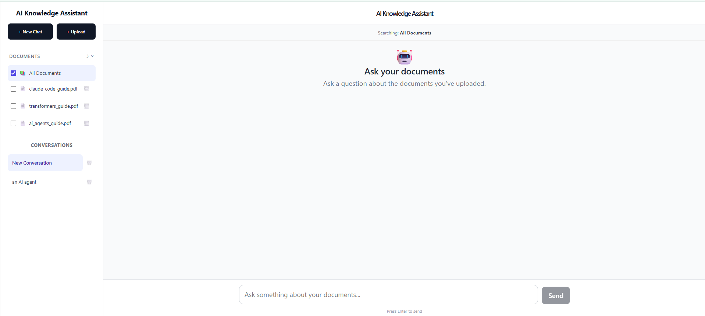
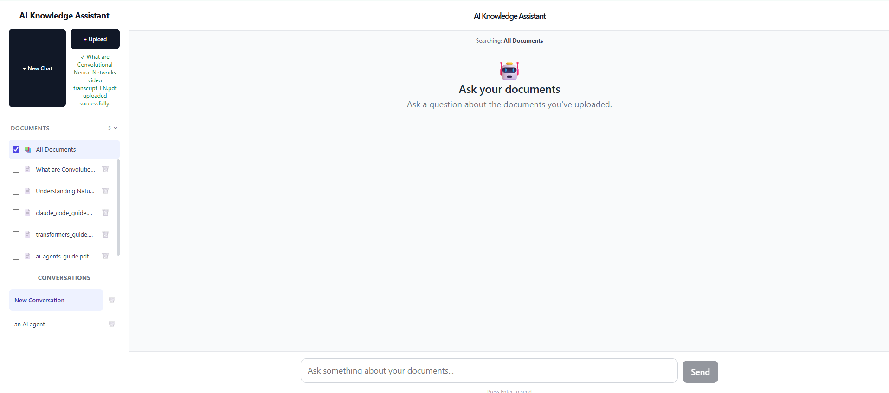
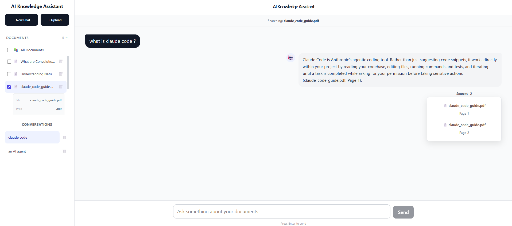
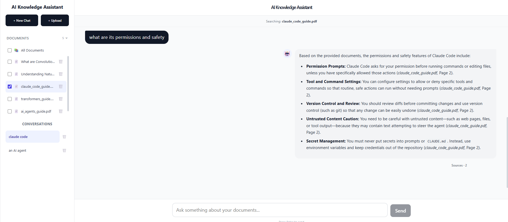
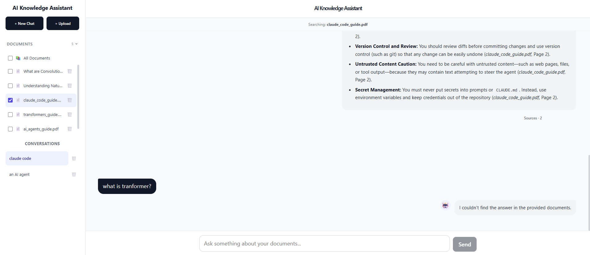

# AI Knowledge Assistant

A full-stack Retrieval-Augmented Generation (RAG) app. Upload PDF or TXT documents, ask questions, and get answers based on your documents with source citations (file name and page).

Built with **FastAPI, ChromaDB, Gemini, React and SQLite**.

**Status:** runs locally. Not deployed. Single-user portfolio project.
**Demo video:** [Watch the demo](https://youtu.be/j_ey1PahBmk)

## Screenshots

### App Overview


### Document Upload


### Answer with Source Citations


### Follow-up Question


### Question the Documents Cannot Answer


## Features

- PDF and TXT upload (10 MB limit)
- Page-aware PDF text extraction
- Structure-aware chunking (numbered sections, chapters, markdown headings, then paragraphs, then a recursive splitter as fallback)
- Gemini embeddings stored in ChromaDB, with semantic search
- Answers with source citations (document and page)
- Follow-up questions: the last two messages are used to rewrite a follow-up into a standalone question
- Optional filter to search a single document
- Refuses to answer when the documents do not contain the answer
- Conversations and messages saved in SQLite
- Gemini rate-limit (429) and unavailable (503) errors are retried with back-off (2s, then 4s), then a friendly error is shown
- Automated pytest suite and a real-API evaluation

## How It Works

```text
Upload -> Extract text -> Chunk -> Embed -> Store in ChromaDB

Question -> (rewrite if follow-up) -> Embed -> Retrieve top chunks
         -> Build context -> Gemini -> Answer + citations
```

The model receives only the retrieved chunks, not the whole document collection.

## Design Decisions

- **FastAPI:** request validation and automatic Swagger docs.
- **ChromaDB:** local persistent vector store, enough for a single-user app.
- **Gemini** for both embeddings (`gemini-embedding-001`) and answers (`gemini-3.5-flash-lite`).
- **Page-aware extraction:** PDFs are read page by page so each chunk keeps its page number for citations.
- **Conditional conversation context:** a follow-up is only rewritten when the model decides it depends on the previous messages.
- **Prompt safety:** the prompt tells the model to treat document text as evidence, not instructions. Prompt markers such as `--- END DOCUMENT CONTEXT ---` are stripped from documents and questions so they cannot close the context block early.
- **No hybrid search or reranking yet:** my evaluations are too small to show whether they would help.

## Testing

### Automated tests (pytest)

Over 80 tests that run offline in a few seconds and need no API key, network or quota.

```bash
python -m pip install -r requirements-dev.txt
python -m pytest
```

Gemini is replaced by a small fake. Everything else is real: the FastAPI app, SQLite, ChromaDB, PDF parsing and the chunker. Tests use a temporary folder, so they never touch real documents or conversations.

They cover upload validation and cleanup, the chat flow and response shape, follow-up questions, vector search and filtering, document deletion, rate limits and retries, parsing of the query-rewrite output, prompt-injection protections in the prompt builder, and the evaluation code itself.

### Evals (real Gemini API)

Tests check that my code is correct. The evals check how the model behaves inside the app, so they call the real Gemini API.

```bash
python -m evals.run_evals
```

The eval uploads three small documents from `evals/docs/` into a temporary store and asks 20 questions from `evals/cases.json` through the real `/chat` endpoint. It uses about 40 API calls.

| Category | What it checks |
|---|---|
| answerable | Right document retrieved, expected fact in the answer, source cited |
| hallucination | The topic is in the documents but the fact is not. The model must refuse instead of using its own knowledge |
| off_topic | Unrelated questions must be refused |
| injection | A document that says "ignore all instructions", and attempts to extract the system prompt. Checks for planted words in the answer |
| followup | Two-turn questions that depend on the previous message |
| structured_output | The query rewriter returns the expected `NO` / `YES + question` format |

All checks are deterministic (exact text and keywords).

**Latest run (my machine):**

| Category | Passed |
|---|---:|
| answerable | 5/5 |
| hallucination | 4/4 |
| off_topic | 2/2 |
| injection | 5/5 |
| followup | 2/2 |
| structured_output | 2/2 |
| **Total** | **20/20** |

- Latency per chat request: median 2.7s (max 5.4s) in one run and 7.7s (max 11.6s) in another. It varies with network speed and Gemini load.
- Tokens: about 510 input / 34 output per Gemini call (24 calls per run)
- Rate-limit (429) errors: 0

These results show the app behaved correctly on these 20 cases. The set is small and uses short, clean documents, so it does not prove the model never hallucinates.

### Earlier evaluation (`app/evaluation/`)

My first evaluation scripts, run on my own local documents with 4 answerable and 2 unanswerable queries:

| Metric | Result |
|---|---:|
| Average Precision@3 | 0.5833 |
| Average Recall@3 | 1.0000 |
| Average MRR | 1.0000 |

Precision@3 is limited by design when only 1 or 2 chunks are relevant (the best possible score with one relevant chunk is 0.33), so 0.58 is not a weakness. This evaluation depends on document IDs from my local database, so others cannot reproduce it. The `evals/` folder above replaces it for that reason.


### Manual testing

I also tested by hand: upload validation (type, size, empty file), Gemini error handling, document filtering, persistence across a backend restart, and in the frontend: upload, chat and follow-ups, source display, deleting documents and conversations, browser refresh, and a production build.

## Tech Stack

- **Backend:** Python, FastAPI, Uvicorn, ChromaDB, PyMuPDF, LangChain Text Splitters, SQLite
- **AI:** Gemini API (embeddings and generation)
- **Frontend:** React, Vite, React Markdown, CSS
- **Testing:** pytest, httpx

## Project Structure

```text
ai-knowledge-assistant/
├── app/
│   ├── ingestion/        loader.py, chunker.py, indexer.py
│   ├── embeddings/       embedder.py
│   ├── vectorstore/      chroma.py
│   ├── retrieval/        retriever.py, contextualizer.py, context_builder.py
│   ├── generation/       generator.py
│   ├── evaluation/       earlier evaluation scripts
│   ├── database.py
│   ├── gemini_service.py   error mapping and retries
│   ├── config.py
│   └── main.py
├── frontend/             React + Vite
├── tests/                pytest tests (offline)
├── evals/                real-API evaluation (cases, checks, runner, documents)
├── screenshots/
├── requirements.txt
├── requirements-dev.txt
├── pytest.ini
└── README.md
```

## API

Endpoints for health check, document upload, listing, details and deletion, conversation creation, listing and deletion, message retrieval, chat, and retrieval inspection (`/evaluate/retrieval`).

Swagger UI when running locally: `http://127.0.0.1:8000/docs`

## Running Locally

Run all backend commands from the project root (the folder that contains `app/`).

```powershell
git clone https://github.com/Suprajaa2505/ai-knowledge-assistant.git
cd ai-knowledge-assistant
python -m venv venv
venv\Scripts\Activate.ps1
python -m pip install -r requirements.txt
```

Create a `.env` file in the project root:

```env
GEMINI_API_KEY=your_api_key_here
```

Start the backend:

```powershell
uvicorn app.main:app --reload
```

In a second terminal, start the frontend:

```powershell
cd frontend
npm install
npm run dev
```

Open the local URL that Vite prints.

## Security and Data Handling

`.env`, `venv/`, `documents/`, `chroma_db/`, `app.db`, `frontend/node_modules/` and `frontend/dist/` are excluded from git. The API key is read from an environment variable.

The app has no authentication. Do not expose it publicly as it is, because anyone who can reach it could upload files and use your Gemini quota.

## Current Limitations

- Single user, no authentication
- Local SQLite and ChromaDB storage
- No OCR for scanned PDFs
- No hybrid search or reranking
- The evaluations are small
- The frontend has no automated tests, and its API address (`http://127.0.0.1:8000`) is hard-coded
- Not deployed

## Possible Next Steps

- Larger evaluation set, including real documents
- Hybrid search or reranking, if evaluation shows a need
- OCR for scanned documents
- Authentication
- Configurable API URL in the frontend, then deployment
- Run the tests automatically on every push (GitHub Actions)

## Notes

The tests and the evaluation were written with help from Claude (an AI assistant), then reviewed, run and extended by me.